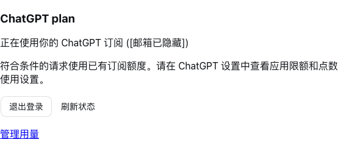
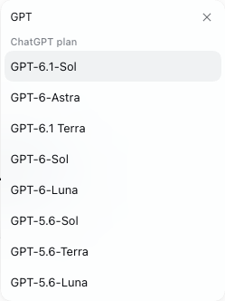

# dsh-chatgpt-plan

English | [中文](README.zh.md)

## Summary

Use your ChatGPT plan to run DSH tasks through OpenAI's official Sign in with ChatGPT flow. This bundle adds the `codex-plan` provider and account controls in Settings → Models. Each user authorizes their own account; eligible requests consume their existing plan allowance. The plugin uses the public Responses API and keeps DSH's agent loop and tools. It is an independent integration, not an OpenAI or DeepSeek endorsement.

## Screenshots

The account controls in Settings → Models (email hidden):



Available models in the model picker. The list depends on your account and may change:



## Table of Contents

- [Use this package](#use-this-package)
- [Understand the implementation](#understand-the-implementation)
- [Further Exploration](#further-exploration)
- [Model Experience](#model-experience)
- [Known Limitations and Deferred Work](#known-limitations-and-deferred-work)

-----

## Use this package

### Requirements and installation

Use Node.js ≥24.9 and DSH **0.2.1-rc.5** or **0.2.2-alpha.2**. This version targets profiles based on `dsh-base`, including Web, Desktop and headless; other DSH versions are rejected by its compatibility declaration. You need a ChatGPT account eligible for SIWC plan usage, with plan usage granted during authorization. Browser sign-in and model discovery have been verified with a real account. Real-account inference remains unverified.

Download the prebuilt package from [GitHub Releases](https://github.com/yossi-lee/dsh-chatgpt-plan/releases/tag/v0.1.3) and install it without a build step:

```sh
curl -fL https://github.com/yossi-lee/dsh-chatgpt-plan/releases/download/v0.1.3/dsh-chatgpt-plan-0.1.3.tgz -o dsh-chatgpt-plan-0.1.3.tgz
dsh plugin --profile web add ./dsh-chatgpt-plan-0.1.3.tgz
dsh web --no-open
```

Restart an already running DSH after installation. GitHub source archives do not contain built code; use the release `.tgz` for installation.

In Desktop, install the local `.tgz` or its release download URL through the plugin manager, then restart Desktop. Version 0.1.2 supported only DSH 0.2.2-alpha.2; use 0.1.3 for DSH 0.2.1-rc.5. Do not disable compatibility checks.

From this checkout, install the built plugin into a CLI-managed profile:

```sh
npm ci --ignore-scripts --legacy-peer-deps
npm run build
dsh plugin --profile web add /absolute/path/to/dsh-chatgpt-plan
dsh --profile web --dump-config
dsh web --no-open
```

The composed configuration contains the `dsh-chatgpt-plan` bundle and `codex-plan` row. Restart an already running DSH after installation. The bundle enables the existing `credentials` and `authorization` rows, including when a headless profile disabled them. Their storage is the DSH credential store, shared by profiles using that store. Desktop owns its own profile; install the tarball through its plugin manager rather than using the CLI's Web profile.

For distribution without a source checkout, build and pack the plugin:

```sh
npm pack
dsh plugin --profile web add /absolute/path/to/dsh-chatgpt-plan-0.1.3.tgz
```

This package is not published to npm. The tarball contains built Host and browser code and requires no installation-time build. Removing the plugin with `dsh plugin --profile web remove dsh-chatgpt-plan` removes its bundle layer; credential records remain in the DSH store.

### Sign in and select a model

Open Settings → Models → ChatGPT plan and choose Continue with ChatGPT. Open the authorization link, sign in on OpenAI's page, and allow plan usage. When the browser cannot reach the DSH Host's loopback listener, paste the complete callback URL into the account card. The card reports success only after token verification and credential storage. Then select a model under ChatGPT plan in DSH's model selector.

Use Cancel sign-in to withdraw a pending attempt. Sign out stops this instance's account requests, attempts remote revocation and clears local tokens; it retains the host ID and account/client registration for later sign-in. If remote revocation cannot be confirmed, the card reports it and directs you to disconnect the application in ChatGPT settings. Manage usage opens ChatGPT's app limits and credit settings.

### Configuration

Override the `codex-plan` row in your profile's `cordis.patch.yml`. DSH applies defaults from the plugin schema for omitted fields. Changes require remounting the plugin or restarting DSH.

| Field | Default | Behavior |
|---|---|---|
| `loginTimeoutMs` | `180000` | Total browser authorization deadline. |
| `requestTimeoutMs` | `180000` | Catalog, inference and revocation operation deadline. |
| `authRequestTimeoutMs` | `15000` | Token/revocation network budget, capped at 20000 to leave room within the store's writer-lock wait. |
| `refreshMarginMs` | `180000` | Refresh before expiry, respecting an issued earliest-refresh time. |
| `revocationRetries` | `1` | Additional revocation attempts after a network error or server failure. |
| `revocationRetryDelayMs` | `250` | Initial exponential-backoff delay for revocation. |
| `callbackPort` | `1455` | Loopback listener port; `0` selects an available port. |
| `modelContextWindows` | `{}` | Explicit per-model context limits when needed; otherwise use catalog metadata. |

Endpoints, OAuth scopes and the provider ID follow this plugin's fixed protocol implementation. Tokens never belong in configuration. If a credentials document is corrupt, the plugin refuses to overwrite it; repair or remove its `codex-plan/connection` record before signing in again.

-----

## Understand the implementation

<details>
<summary>Implementation and development</summary>

The [bundle patch](cordis.patch.yml) enables the existing credential services and inserts one plugin row. [Authentication](src/auth.ts) persists one host ID and one account registration in the DSH store, verifies ID tokens with JWKS, and rotates credentials under the store's cross-process lock. A lost refresh response invalidates the local token set because its refresh token may already have rotated.

The [adapter](src/adapter.ts) binds a request to its login generation and calls `api.openai.com/v1/models` and `/responses`. The [message conversion](src/messages.ts) uses namespaced tools and validates account/model-scoped replay metadata. The [stream translator](src/stream.ts) emits DSH blocks and accepts success only after a completed response. [Account controls](src/client/index.tsx) call credential-free Remote methods; tokens stay on the Host. The plugin never imports Codex's login files or launches Codex CLI.

For development against a sibling DSH checkout, install dependencies, link the actual harness packages, then check and build:

```sh
npm ci --ignore-scripts --legacy-peer-deps
npm run link:dsh -- ../dsh
npm run typecheck
npm test
npm run verify:dsh -- ../dsh
```

The link script changes only this project's `node_modules`. Type checks use DSH's real declarations, not local replacement declarations. The verification script installs the plugin into disposable profiles using `pnpm dsh`, runs an offline headless task through a real tool round trip, resumes it after a process restart, and compares [the request snapshot](tests/session.expected.json). It does not use an API key or your existing Codex authentication. Browser sign-in/cancellation was checked separately against an isolated Web profile.

</details>

-----

## Further Exploration

- [DSH: your first plugin](https://deepseek-harness.github.io/deepseek-harness/develop/basic/), [packaging](https://deepseek-harness.github.io/deepseek-harness/develop/basic/publish), and [LLM adapters](https://deepseek-harness.github.io/deepseek-harness/develop/practice/llm-adapter).
- [OpenAI SIWC overview](https://developers.openai.com/siwc/token-sharing-open-source), [sign-in](https://developers.openai.com/siwc/token-sharing-open-source/sign-in), and [preview limitations](https://developers.openai.com/siwc/token-sharing-open-source/preview-limitations).

## Model Experience

### Requests and tool results

#### What the model sees

The model receives DSH's retained text history and tools grouped under the `dsh` namespace, described as `Tools executed by DeepSeek Harness.` Tool results correlate by call ID. Validated native reasoning and response items are replayed only for the same model and login generation, with unchanged visible content. The adapter adds no persona or task instructions.

#### Token effect

Each HTTP request supplies the required history with `store: false` and `stream: true`. Token use counts against the authorized account's eligible plan allowance. Unsupported controls fail explicitly, and neither the SDK nor the adapter automatically retries inference or switches to API-key billing.

#### KV Cache effect

Unchanged history retains its native item order, phase and encrypted reasoning. Editing or pruning content, changing models, or reauthorizing invalidates affected native replay. Provider cache availability remains outside this plugin's control.

## Known Limitations and Deferred Work

- One account registration per credential store; multi-account selection and workspace switching are not implemented.
- Text input and DSH function tools are supported. The adapter advertises text-only input so DSH projects attachments; native image/file input and hosted tools are not exposed.
- Model availability comes from the account catalog. Reasoning choices are limited to efforts also supported by the installed Responses SDK; extra server-advertised efforts do not invalidate a model. Unknown or unavailable models are refused. Catalog metadata can be incomplete; context overrides are explicit.
- Web installation and keyless headless execution are verified on macOS. Desktop-native behavior, Windows ACL protection and real-account inference remain unverified.
- The callback listener must bind its configured loopback port. A busy default port fails visibly; configure another port or `0`.

### Dev Note

This preview is not published to npm. Browser authorization and model discovery have been verified with an eligible account; real-account multi-step tasks, token rotation and revocation still need verification.

The package and display name changed from `dsh-codex-plan` / Codex plan to `dsh-chatgpt-plan` / ChatGPT plan in 0.1.2. Remove the old package before installing the new one. Internal provider, configuration, credential, and replay identifiers remain `codex-plan` to preserve saved sessions and sign-in.

Version 0.1.3 adds DSH 0.2.1-rc.5 support. Development dependencies target that older release; the test suite and built-package install/tool/session-recovery checks pass against it. The installed Desktop runtime also passes browser account-card mount and sign-in start/cancel checks. Catalog invalidation uses credential events shared by both supported releases.
